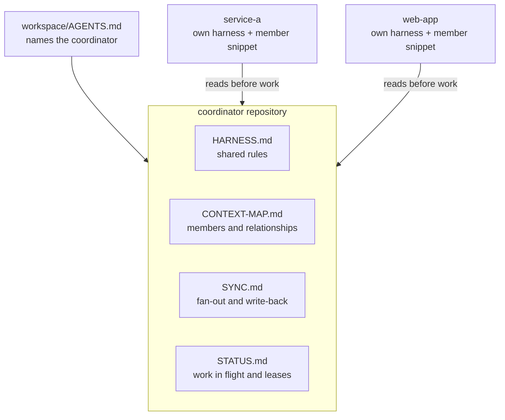

# Agentic Engineering Skills & Harness

[](https://github.com/ldaume/agentic-engineering-harness/actions/workflows/validate.yml)
[](./LICENSE)

Agent Skills and a working harness that let coding agents change your
repositories under rules, context, and checks you can read and review in Git.
Install a single Skill, give one repository a harness, or connect several
repositories through one coordinator. Works with Claude Code, Codex, Cursor,
and Gemini CLI.

I am [Leonard "Lenny" Daume](https://www.daume.dev). These are the Skills and
harness patterns I run my own agent work on, across product, engineering,
delivery, and operations.

## Try it in 60 seconds

Inside the repository you want agents to work in (requires Node.js):

```bash
npx skills add ldaume/agentic-engineering-harness \
  --skill scaffold-harness --skill agent-sync --skill grill-harness-with-docs \
  --agent claude-code --copy -y
```

Use `codex`, `cursor`, or `gemini-cli` instead of `claude-code` for another
host. The Skills are copied into the project (`.claude/skills/` for Claude
Code), so you can read them before the first run. Then start your agent and
ask:

```text
Use scaffold-harness to assess this repository. Recommend an operating level,
show me what you would add, and wait for my yes before changing anything.
```

The agent reads the repository and names its real Fast Check and Full Gates.
It proposes the context files the repository needs, starting with `AGENTS.md`
and `HARNESS.md`, and lets you choose how much it does on its own. The
complete prompts for one repository and for a workspace are under
[Choose a first prompt](#choose-a-first-prompt).

## What you get

| Part | What it gives you | Built by |
|---|---|---|
| [Skills catalog](#catalog) | 46 Skills for engineering, product, design, writing, frontend, backend, infrastructure, and testing. Each one works on its own. | `npx skills add` |
| Repository harness | Agent instructions, context, checks, and an operating level from L1 to L7, stored as Markdown in the repository | [`scaffold-harness`](./skills/engineering/scaffold-harness/SKILL.md) 3.1.0 |
| Multi-repository workspace | A working root and a coordinator repository that every agent session reads before it works | [`scaffold-harness`](./skills/engineering/scaffold-harness/SKILL.md#multi-repository-workspace) 3.1.0 |
| Upkeep | Instructions, Skills, and routing that stay current from what each session learns | [`agent-sync`](./skills/engineering/agent-sync/SKILL.md) 2.1.0 |

## How a workspace fits together



The workspace directory holds the repositories side by side. The coordinator
is an ordinary repository that holds relationships, shared rules, and status.
Each member keeps its own harness and carries the same short snippet that
points at the coordinator. A session that starts in any member reads the same
rules first, and a lesson that applies everywhere reaches every member in one
loop. The templates are in
[`scaffold-harness/templates/workspace`](./skills/engineering/scaffold-harness/templates/workspace/);
[`docs/BEYOND-ONE-REPOSITORY.md`](./docs/BEYOND-ONE-REPOSITORY.md) explains
what changes for people once work spans repositories.

## How it is checked

Every push runs [Validate Skills](./.github/workflows/validate.yml):

- a catalog audit of every Skill's name, description, size, links, lock
  entry, and prose
- the plain punctuation gate
- unit tests for the `scaffold-harness` templates and scripts, the merge gate
  script, the writing quality gate with its golden outputs, and the design
  scripts
- a reference form driven in a real Chromium browser with Playwright
- an install of the whole catalog into Codex, Cursor, Claude Code, and Gemini
  CLI

Each Skill carries its own version and GitHub Release
([`VERSIONING.md`](./VERSIONING.md)), so you can pin an exact tag.

## Scope

This catalog is the open part of a larger system: the craft Skills in full,
and the harness for one repository or a workspace of several repositories
that share a coordinator. The [levels](./docs/LEVELS.md) show the whole path
to L7. My own automation for the upper levels stays private; I build such
systems with teams: [daume.dev](https://daume.dev).

Humans keep goals, policy, risk, and accountability; agents carry as much
execution as the proven controls allow. The install test proves packaging for
four hosts. Hosts still differ in when they trigger a Skill, so check that a
real session loads what you installed.

## Start here

| Goal | Start with |
|---|---|
| Inspect the catalog | `npx skills add ldaume/agentic-engineering-harness --list` |
| Audit or establish a repository or multi-repository workspace harness | [`scaffold-harness`](./skills/engineering/scaffold-harness/SKILL.md) |
| Choose or switch how much agents do alone | [`MATURITY.md`](./skills/engineering/scaffold-harness/MATURITY.md#choosing-and-switching-the-operating-level) |
| Keep a harness current across sessions | [`agent-sync`](./skills/engineering/agent-sync/SKILL.md) |
| Deliver a dependency upgrade through production | [`deliver-dependency-upgrades`](./skills/engineering/deliver-dependency-upgrades/SKILL.md) |
| Shape value-defined issues and honest roadmaps | [`product-craft`](./skills/product/product-craft/SKILL.md) |
| Write numbers a non-participant reads correctly | [`plain-numbers`](./skills/product/plain-numbers/SKILL.md) |
| Design a flow, form, product screen, site, dashboard, or deck with evidence | [`skills/design`](./skills/design/README.md) |
| Write an email, status, hero, PR, or commit with its golden path | [`skills/writing`](./skills/writing/README.md) |
| Run the full signal-to-outcome loop | [`run-product-engineering`](./skills/product/run-product-engineering/SKILL.md) |
| Understand what changes beyond one repository, and how the workspace is built | [`docs/BEYOND-ONE-REPOSITORY.md`](./docs/BEYOND-ONE-REPOSITORY.md) |

## Operating levels

Every harness records one operating level: how much agents do on their own.

| Level | Agents do on their own | You still do |
|---|---|---|
| L1 Directly supervised task | One bounded task in one session | Frame the task and review the result |
| L2 Repeatable procedure | One recurring method from a versioned Skill | Choose the procedure and judge repeated results |
| L3 Living repository | Change code, run checks, keep context and learnings, commit | Own intent, domain meaning, and material decisions |
| L4 Grounded system | Also use external sources and tools within named access | Approve new access and consequential external effects |
| L5 Stateful workflow | Also run a recurring workflow end to end, retry, and recover | Handle exceptions and open decisions |
| L6 Governed value stream | Also merge, deploy, and roll back proven change classes | Set goals and risk; veto, incidents, accountability |
| L7 Adaptive product system | Also choose bounded problems and experiments | Set strategy, budgets, and decision domains; stop the system |

What each level means, what a human still does there, and the evidence that
earns the next one: [`docs/LEVELS.md`](./docs/LEVELS.md).

## Install

Requires Node.js (`npx`). Review the source and requested scope before a global installation. Installed
Skills run through an agent with that agent's permissions, and `-y` skips the
Skills CLI confirmation.

```bash
npx skills add ldaume/agentic-engineering-harness --list
npx skills add ldaume/agentic-engineering-harness \
  --skill scaffold-harness \
  --skill agent-sync \
  --skill update-harness \
  --skill grill-harness-with-docs \
  --skill write-a-skill \
  --agent codex cursor claude-code gemini-cli \
  --copy -g -y
```

Replace the example client list with every agent host you actually use (`npx skills add --help` lists the ids), then
check that a real session loads what you installed: hosts differ in what
triggers a Skill. Install only these five bootstrap Skills globally (installs track the default branch; for exact pins see [`VERSIONING.md`](./VERSIONING.md#consumers)); keep
project and domain Skills in the target repository so they stay visible and
scoped. Use
[`write-a-skill`](./skills/engineering/write-a-skill/SKILL.md) whenever an agent
creates or changes a Skill.

To install one Skill into the current project from a local clone (`git clone https://github.com/ldaume/agentic-engineering-harness`):

```bash
npx skills add /path/to/agentic-engineering-harness \
  --skill coding-discipline \
  --agent codex \
  --copy -y
```

The validation workflow install-tests the catalog for Codex, Cursor, Claude
Code, and Gemini CLI. That is packaging compatibility, not identical runtime
behavior; Pi, CI, and later runtimes need a target-owned adapter first.

## Choose a first prompt

Start the agent inside the repository it should change, because the harness it
builds is that repository's own.

### One repository

```text
First verify that the working root is the target repository root. If it is not,
stop and name the correct working root before installing or changing anything.

Use the Skills from
https://github.com/ldaume/agentic-engineering-harness.

Inspect that source. If any Skill named in this prompt is unavailable, install
only that missing Skill project-locally for the active agent host. Do not
install globally or expand permissions without explicit authority.

Use scaffold-harness to assess this repository and add only the context,
capabilities, feedback, and governance it needs. Preserve local truth,
recommend an operating level from what the repository already has and let me
choose it, name the real Fast Check and Full Gates, and
verify the result with those repository checks. Use grill-harness-with-docs
for shared understanding, material critique, and unresolved decisions, and
run agent-sync before completion.
```

### A workspace of several repositories

Start the agent in the directory that holds the repositories side by side.

```text
The working root is a workspace directory that holds several repositories
side by side. Do not change any repository before I confirm the plan.

Use the Skills from
https://github.com/ldaume/agentic-engineering-harness.

Inspect that source. If any Skill named in this prompt is unavailable, install
only that missing Skill project-locally for the active agent host. Do not
install globally or expand permissions without explicit authority.

Use scaffold-harness, section Multi-Repository Workspace: list the
repositories here with their remotes and existing agent instructions, propose
which repository coordinates and which belong, and show the planned workspace
root AGENTS.md, coordinator CONTEXT-MAP.md, SYNC.md, STATUS.md, and the member
snippet. After my yes, give each member its own harness, add the snippet to
each member, merge into existing files instead of replacing them, commit each
repository separately, and verify from one member that a fresh session reaches
the coordinator. Run agent-sync before completion.
```

For what each level means and what changes once work spans several
repositories, read [`docs/LEVELS.md`](./docs/LEVELS.md) and
[`docs/BEYOND-ONE-REPOSITORY.md`](./docs/BEYOND-ONE-REPOSITORY.md).

## Working principles

1. **One product loop.** Signal, discovery, implementation, delivery,
   operations, and evolution share evidence and ownership.
2. **DDD plus vertical TDD.** Domain language and boundaries guide design;
   small executable slices test both behavior and understanding.
3. **Shift assurance left.** Security, compliance, operability, accessibility,
   and recovery enter when a decision is still cheap to change.
4. **Autonomy through evidence.** Permissions and blast radius grow only when
   checks, observability, recovery, and representative results justify them.
5. **Git-owned truth.** Decisions, controls, checks, and evidence stay concise,
   versioned, reviewable, and close to the work.

## Core Skills and technology profiles

Portable means a reusable installation and invocation contract, not that every
Skill is language-neutral or every host behaves identically.

The core contains methods that transfer across stacks:

- Product system: [`product-craft`](./skills/product/product-craft/SKILL.md),
  [`run-product-engineering`](./skills/product/run-product-engineering/SKILL.md),
  [`integrate-product-compliance`](./skills/product/integrate-product-compliance/SKILL.md)
- Infrastructure system:
  [`manage-infrastructure-as-code`](./skills/infrastructure/manage-infrastructure-as-code/SKILL.md)
- Harness and agents: [`scaffold-harness`](./skills/engineering/scaffold-harness/SKILL.md),
  [`agent-sync`](./skills/engineering/agent-sync/SKILL.md),
  [`update-harness`](./skills/engineering/update-harness/SKILL.md),
  [`grill-harness-with-docs`](./skills/engineering/grill-harness-with-docs/SKILL.md),
  [`build-autonomous-agents`](./skills/engineering/build-autonomous-agents/SKILL.md),
  [`deliver-dependency-upgrades`](./skills/engineering/deliver-dependency-upgrades/SKILL.md),
  [`learn-agentic-engineering`](./skills/engineering/learn-agentic-engineering/SKILL.md),
  [`write-a-skill`](./skills/engineering/write-a-skill/SKILL.md)
- Engineering method: [`start-gate`](./skills/engineering/start-gate/SKILL.md),
  [`coding-discipline`](./skills/engineering/coding-discipline/SKILL.md),
  [`completion-gate`](./skills/engineering/completion-gate/SKILL.md),
  [`shift-left-security`](./skills/engineering/shift-left-security/SKILL.md),
  [`documentation-and-adrs`](./skills/engineering/documentation-and-adrs/SKILL.md),
  [`api-design`](./skills/backend/api-design/SKILL.md),
  [`testing-strategies`](./skills/testing/testing-strategies/SKILL.md)

`frontend-craft` and `backend-craft` are standalone Skills; shared end-to-end
craft lives in `coding-discipline`. Opinionated profiles carry real stack
knowledge (pnpm monorepos, Meilisearch, Playwright, Gitea, Docker, Ansible,
secure Linux hosting) where generic advice would be weaker. Missing coverage is
resolved by reusing an existing Skill or writing a project-local one with
`write-a-skill`.

## Catalog

| Category | Skills |
|---|---|
| [Engineering](./skills/engineering/README.md) | `scaffold-harness`, `agent-sync`, `update-harness`, `grill-harness-with-docs`, `start-gate`, `coding-discipline`, `completion-gate`, `shift-left-security`, `documentation-and-adrs`, `deliver-dependency-upgrades`, `build-autonomous-agents`, `learn-agentic-engineering`, `write-a-skill`, `scaffold-monorepo`, `pnpm` |
| [Product](./skills/product/README.md) | `product-craft`, `run-product-engineering`, `integrate-product-compliance`, `plain-numbers` |
| [Design](./skills/design/README.md) | `design-core`, `design-research`, `design-flows`, `design-forms`, `design-product-ui`, `design-web`, `design-dataviz`, `design-slides`, `design-systems`, `design-review` |
| [Writing](./skills/writing/README.md) | `writing-core`, `writing-editorial`, `writing-marketing`, `writing-product`, `writing-engineering` |
| [Frontend](./skills/frontend/README.md) | `frontend-craft` |
| [Backend](./skills/backend/README.md) | `api-design`, `backend-craft`, `meilisearch` |
| [Infrastructure](./skills/infrastructure/README.md) | `manage-infrastructure-as-code`, `ansible-automation`, `gitea-actions`, `gitea-tea`, `multi-stage-dockerfile`, `secure-linux-web-hosting` |
| [Testing](./skills/testing/README.md) | `testing-strategies`, `playwright-best-practices` |

[`skills-lock.json`](./skills-lock.json) is the complete versioned catalog.
`system-one-routing` and `scaffold-distributed-context` are retired; their
last public tags are listed in the [engineering catalog](./skills/engineering/README.md).

## Repository maintenance

Agents start at [`AGENTS.md`](./AGENTS.md), which also holds the Fast Check.
Release rules are in [`VERSIONING.md`](./VERSIONING.md), prose style in
[`VOICE.md`](./VOICE.md), and contribution policy in
[`CONTRIBUTING.md`](./CONTRIBUTING.md): consume and adapt; external pull
requests are not the supported path.

## License

MIT. See [`LICENSE`](./LICENSE).
