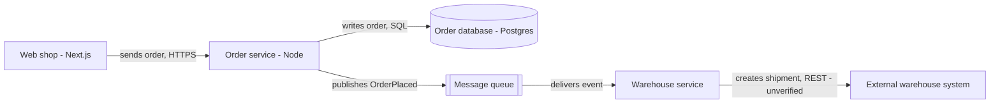

# Diagrams

## Intent

A diagram answers one question about a system - what talks to what, what
happens in which order, which states exist - correctly, at one level of
detail, with every box and arrow named, and with a text alternative and an
editable source.

## Trigger

An architecture or system map, C4 view, deployment view, sequence, state,
data model, or process diagram; choosing a diagram-as-code format; reviewing
an existing diagram. A flowchart of a user journey is a design artifact
with its own states and edge cases - `progressive-user-flows` owns it.

## Required context

- The question the diagram answers and who asks it.
- The source of truth for the entities: code, infrastructure config, an ADR,
  interviews. What the diagram shows without a source is a hypothesis.
- Where it lives: docs repository, slide, wiki, ticket; and who maintains it.

## Workflow

1. **Question first.** Write it as the title's subtitle ("How does an order
   reach the warehouse?"), because a diagram without a question grows until
   it shows everything and answers nothing (hypothesis).
2. **Entities and relations.** List the nodes (name, type, responsibility,
   technology) and the edges (from, to, what flows, protocol) as text before
   drawing. Mark each item as sourced (file, config, ADR) or unsourced; an
   unsourced item is drawn with a visible "unverified" marker, because a
   diagram is read as fact (hypothesis).
3. **Abstraction level.** One level per diagram. For software architecture
   use C4: system context for executives and other teams, container for
   engineers who deploy and operate, component for those who change the
   code; add deployment or dynamic views when the question is about runtime
   or order (supported) [SRC-VIZ-030].
4. **Type** (decision tree below).
5. **Reading direction and grouping.** Pick one main direction and keep it -
   left to right for a flow of data or requests, top to bottom for
   hierarchy or time in sequence diagrams - and start where the reader's
   question starts (hypothesis; no source on diagram reading direction was
   found). Group related nodes by proximity and a labeled boundary, and keep
   unrelated ones apart, because proximity reads as a group and can override
   color or shape (supported) [SRC-VIZ-029]. Re-check the grouping at the
   size it will be viewed (supported) [SRC-VIZ-029].
6. **Labels.** Title, type, and scope on the diagram; every element with
   name, type, and technology; every arrow labeled with a verb phrase that
   reads in the arrow's direction, with protocol where relevant; a legend
   for every color, shape, border, and line style; acronyms explained
   (supported) [SRC-VIZ-031]. Color is never the only carrier of meaning
   (verified) [SRC-VIZ-007].
7. **Edge cases.** Show what the question needs beyond the happy path:
   failure paths, retries, async queues, external dependencies, trust
   boundaries; leave the rest out and say so in the scope (hypothesis).
8. **Semantic correctness check.** Walk every edge against the source of
   truth: does this call exist, in this direction, with this protocol? Does
   every node in the code or config that matters for the question appear?
   Ask an owner of the system to read it. Renderers prove syntax, not truth
   (hypothesis).
9. **Accessible text alternative.** A title and a description that lists
   the nodes and relationships in reading order, visible next to the
   diagram or directly below it, because a rendered SVG does not convey the
   graph structure to a screen reader (supported) [SRC-VIZ-011]; the text
   source is also what renderers like Mermaid read [SRC-VIZ-032].
10. **Editable source.** Commit the diagram as text next to the code or doc
    it describes, so a change to the system can change the diagram in the
    same review (hypothesis).

## Decision tree - diagram type

- Who uses the system and which systems does it touch -> C4 system context
  (supported) [SRC-VIZ-030].
- Which deployable parts exist and how they talk -> C4 container
  (supported) [SRC-VIZ-030].
- Where it runs -> deployment diagram (supported) [SRC-VIZ-030].
- What happens in which order between parts -> sequence diagram, or a C4
  dynamic view (supported) [SRC-VIZ-030].
- Which states an object goes through and what moves it -> state diagram.
- How data is structured and related -> entity-relationship diagram.
- How work moves between people or teams -> swimlane process diagram; a
  user's path through the product goes to `progressive-user-flows`.
- Quantities -> not a diagram; a chart from `progressive-data-visualization`.

## Source formats

| Need | Default | License |
|---|---|---|
| Quick, text-versioned diagram in docs or a README | Mermaid | MIT (verified) [SRC-VIZ-033] |
| Architecture diagram with more layout control, containers, many output formats | D2 | MPL 2.0 (verified) [SRC-VIZ-034] |
| Programmatic graph layout, large generated graphs | Graphviz `dot` | EPL 2.0 for current versions (verified) [SRC-VIZ-035] |
| Layout computed in JavaScript for your own renderer | elkjs | not verified in the registry; see gaps |

- Mermaid covers flowchart, sequence, class, state, ER, Gantt, C4, and more
  (verified) [SRC-VIZ-033]. Use `accTitle` and `accDescr` - they become the
  SVG `title` and `desc` with ARIA links - and still write the visible
  description, because the project calls its accessibility work a start
  (verified) [SRC-VIZ-032].
- D2 renders SVG, PNG, PDF, and PPTX; per-container direction and locked
  positions need its TALA engine, whose license was not stated, so check it
  before bundling; Dagre cannot connect a container to its own child
  (verified) [SRC-VIZ-034].
- ELK computes positions only, no rendering (supported) [SRC-VIZ-036].
- Automated gate: render in CI (`mmdc`, `d2`, `dot`) and fail on a nonzero
  exit. That proves the source parses; layout legibility and meaning stay
  manual.

## Anti-patterns

- Unlabeled arrows, unexplained colors, no legend, no scope (supported)
  [SRC-VIZ-031].
- Several abstraction levels in one diagram (supported) [SRC-VIZ-030].
- Unrelated nodes placed close together so they read as a group
  (supported) [SRC-VIZ-029].
- A diagram drawn from memory with no marker for what is unverified
  (hypothesis).
- A diagram as an image only, with no source and no text alternative
  (verified) [SRC-VIZ-011].

## Example

C4 container view for "How does an order reach the warehouse?", Mermaid
source with on-screen labels in English; the German version translates the
labels, not the identifiers.

- DE labels: "sendet Bestellung", "schreibt Bestellung", "veröffentlicht
  OrderPlaced", "liefert Ereignis", "legt Sendung an - unbestätigt".
- The last edge is marked unverified because no config or contract for the
  external API was found; the semantic check asks its owner.
- The visible description under the diagram repeats `accDescr`.

## Agent prompt

"State the question and the audience. List nodes and edges as a table with
a source for each, marking unsourced items. Pick one C4 level and the
diagram type, draw it in Mermaid or D2 with every arrow labeled, add
accTitle and accDescr and a visible description, render it, and list what
an owner must confirm."

## Evidence gaps

- No primary source on diagram reading direction; the grouping rule rests on
  NN/g's proximity article, applied by analogy [SRC-VIZ-029].
- ELK, elkjs, and TALA licenses were not stated on the pages read for the
  registry [SRC-VIZ-036]; open the LICENSE file before bundling.
- The tooling research recorded Graphviz as EPL 1.0 from memory; the
  Graphviz license page in the registry says EPL 2.0 for current versions,
  which this file follows [SRC-VIZ-035].
- C4 has no empirical evaluation; it is a practitioner model
  [SRC-VIZ-030].
