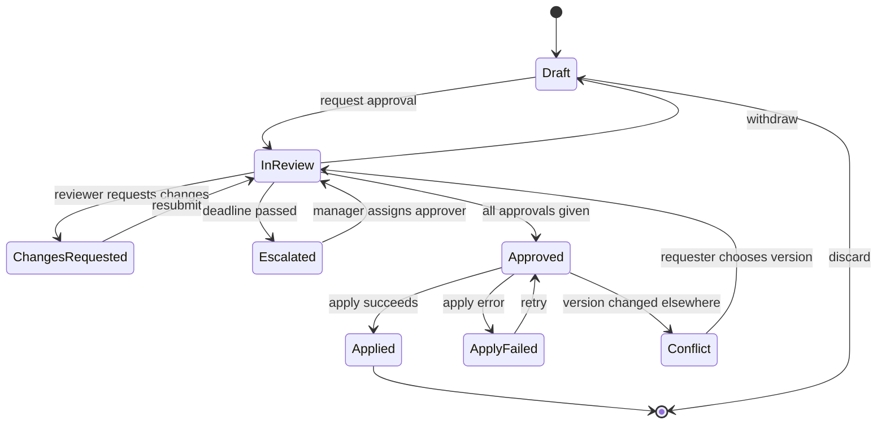

# Flow: Get a contract change approved

Person and context: an account manager (requester) changes contract terms in
a B2B SaaS; a legal reviewer and a finance approver must both agree. Works on
desktop and phone; reviewers are often notified by email.
Done means: the change is approved and applied, or the requester knows why
not and what to do next.

## Happy path

1. Requester edits terms and selects "Request approval" - the system saves a
   version and notifies legal and finance; the requester sees "Waiting for
   legal and finance" with both names.
2. Legal approves - status shows "Legal approved, waiting for finance".
3. Finance approves - the change applies; everyone sees "Approved and
   applied" with the version and time.

## Alternative paths

- A reviewer requests changes with a comment - the requester edits and
  resubmits; earlier approvals are reset only if the changed clauses are in
  that reviewer's scope.
- The requester withdraws the request before approval - back to draft.

## Error and recovery

| Failure | Detected by | What the person sees | Recovery | Input kept |
|---|---|---|---|---|
| Notification fails | Mail bounce | Banner to requester: "Finance was not notified" | Resend or pick another approver | Yes |
| Apply fails after approval | Server error | "Approved, not applied yet" | Retry; support link with the request id | Yes |
| Approver lost permission | Permission check on open | "You can no longer approve this" | Request is re-routed to the role's owner | Yes |
| Conflict: terms changed elsewhere | Version check on apply | Both versions side by side | Requester chooses, approval restarts for changed clauses | Yes |

## Interruptions and resume

| Interruption | State kept | Resume entry | Retention |
|---|---|---|---|
| Reviewer closes the tab mid-comment | Draft comment | Same request, comment restored | 30 days |
| Session expires | Request and comment draft | Sign in returns to the request | Until the request closes |
| Deadline passes (5 working days) | Request | Escalates to the approver's manager | Until resolved |

## Roles and permissions

| Role | Can | Cannot | What they see instead |
|---|---|---|---|
| Requester | Edit, submit, withdraw | Approve own request | Status and current owner |
| Legal reviewer | Approve, request changes | Edit terms | Diff of changed clauses |
| Finance approver | Approve, request changes | Edit terms | Diff with price impact |

## States

## Acceptance criteria and test scenarios

- Given a request in review, when legal approves, then finance sees "Your
  approval is the last one needed" and the requester sees one approval left.
- Given an approval and a failing apply, when the apply returns an error,
  then the status reads "Approved, not applied yet" and a retry is offered.
- Given a session expiry while commenting, when the reviewer signs in again,
  then the comment draft is restored on the same request.
- Given keyboard only, when the reviewer opens the request, then focus lands
  on the heading and the diff is reachable before the decision buttons.

## Analytics events

| Event | When | Question it answers |
|---|---|---|
| approval_requested | submit | How many changes need approval? |
| changes_requested | reviewer asks | Which clauses cause rework? |
| approval_escalated | deadline | Where do approvals stall? |
| apply_failed | apply error | How reliable is applying? |

## Assumptions to test

- Reviewers decide from the clause diff without opening the full contract -
  test: five reviewer walkthroughs per role with real diffs.
